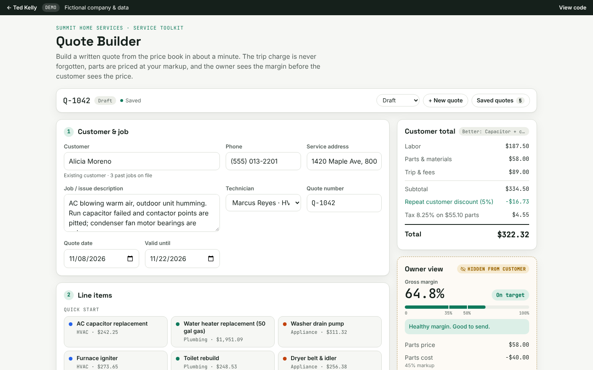

# Quote Builder

Build a professional, correctly priced service quote in about a minute, see your margin before you send it, and give the customer a link to approve it.

**▶ [Live demo: tedkelly.dev/projects/quote-builder](https://tedkelly.dev/projects/quote-builder/)** · part of the [Service Business Toolkit](https://tedkelly.dev/projects/)



## The problem

In most HVAC, plumbing and appliance shops, quotes get built by hand or in a spreadsheet. The trip charge gets forgotten. A part goes out at cost because nobody looked up the markup. Nobody knows the margin until the job is done. And the customer waits a day or two for a written quote, which gives them time to call someone else.

## What it does

- **Builds from your price book.** Search labor, fees and parts by trade, or start from a common job ("AC capacitor replacement", "Water heater replacement (50 gal gas)", "Washer drain pump", "Furnace igniter" and more) with the trip charge and labor hours already in.
- **Prices it right.** Parts come in at your markup and are flagged if someone prices them under book or below cost. There's a one-click after-hours rate, discounts by percent or dollar amount (senior/veteran, repeat customer, coupon), and sales tax on parts only. If the trip charge is missing, it tells you.
- **Good / Better / Best.** Show the customer up to three packages side by side, like repair vs. replace. Customers who get options tend to pick the middle one.
- **Owner view, hidden from the customer.** Parts cost vs. price, labor revenue, tech labor cost, gross profit and margin %, with a red / amber / green check against a 50% target and a plain-English hint.
- **A quote the customer takes seriously.** A clean, branded document with a signature line. Print it or save it as a PDF in one click.
- **An approve link.** Copy a link and text it to the customer. They open it on their phone, pick an option, type their name and tap **Approve**, or ask a question. The approval comes back with their name and a timestamp, and the quote is marked Approved.
- **Saved quotes** with Draft / Sent / Approved / Declined status, plus open, duplicate and delete.

## Try it

**https://tedkelly.dev/projects/quote-builder/**

An example Good / Better / Best AC quote is loaded on your first visit. Click **Copy approval link**, then **Open customer view** to see what the customer gets, and approve it.

## Built with

- Plain HTML, CSS and JavaScript. No framework and no build step, hosted on GitHub Pages.
- Shared demo data and styles from `shared/` (fictional "Summit Home Services": price book, techs, customers, rates).
- Money math is done in whole cents. Each line is rounded to the cent, and the subtotal, discount, tax and total are all built from those rounded lines, so the document always adds up. A discount is spread across the quote, so the parts share of it also comes off the taxable amount. The math is a pure function at the top of `app.js` that can be `require()`d and tested in Node.
- The approval link puts the quote in the URL hash as base64 JSON (`#q=...`). It holds only what the customer sees. Costs and margin are never included.
- The print stylesheet prints only the quote document, so "Save as PDF" in the browser gives you a clean PDF without a PDF library.
- Quotes and approvals are saved in the browser's `localStorage`.

**Demo limits:** approvals are stored only in the browser they were made in, and "Ask a question" doesn't send anything. A production version would save to a database (or your existing field-service software), send the link by SMS or email, and notify the office when a customer approves.

## Note

Summit Home Services is a fictional company. Every customer, phone number, price and quote in this demo is made up.

## Run it locally

No install or build step. Clone the repo and open `index.html` in a browser, or serve the folder:

```bash
git clone https://github.com/TedKelly561/quote-builder.git
cd quote-builder
python3 -m http.server 8000   # then open http://localhost:8000
```

`shared/data.js` holds the fictional company (Summit Home Services) shared by every demo in the toolkit.

## More from the toolkit

- [Work Order Intake](https://github.com/TedKelly561/work-order-intake): messy email → clean service ticket
- [Quote Builder](https://github.com/TedKelly561/quote-builder): price-book quotes with margin view and approve links
- [Dispatch Board](https://github.com/TedKelly561/dispatch-board): drag-and-drop dispatch with first-call deadline alerts
- [Owner's KPI Dashboard](https://github.com/TedKelly561/kpi-dashboard): the numbers that run a service business

## About

Built by **Ted Kelly**, who runs a service business and builds the software behind it. Want something like this for your business? Visit **[tedkelly.dev](https://tedkelly.dev)**.

## License

[MIT](LICENSE). All companies, people, addresses and claim numbers in this demo are fictional.
